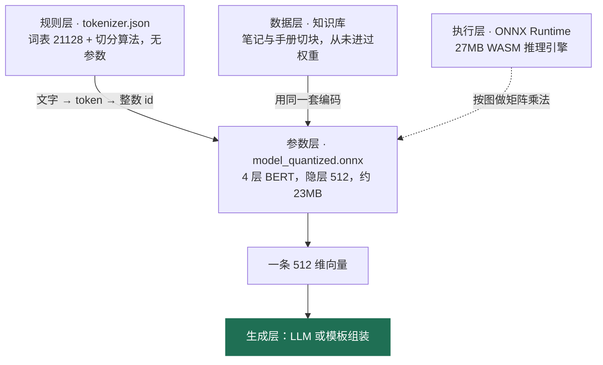
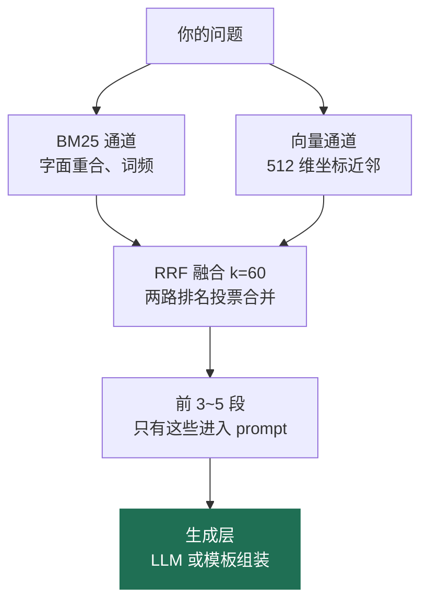

# 本地知识库是怎么工作的：一次把 ONNX、Tokenizer 和「知识库」讲清楚

> 适合读者：会写一点代码、想搞清本地 AI 笔记 / AI 搜索原理的人。  
> 预计阅读：12 分钟。  
> 一句话结论：模型没有被「教」会你的笔记，它只是学会了把一句话摆到一个坐标系里的某个位置。

---

## 一、背景：为什么桌面软件开始自带知识库

过去两年，三件事同时发生，让「装完就能离线问答」从演示变成了可交付的产品：

1. **Embedding 模型变小了。** 中文检索用的 `bge-small-zh-v1.5` 只有 4 层、24M 参数，普通笔记本 CPU 就能跑。
2. **量化成熟了。** 同一份权重从 fp32（约 96MB）压到 int8（约 24MB），体积和内存都降到四分之一，CPU 上反而更快。
3. **用户开始在意隐私和账单。** 在 BYOK（用户自带 API Key）的模式下，每一次云端调用都是用户自己掏钱，能本地答的就不该上云。

于是出现了一种很自然的打包形态：安装包里塞一个 24MB 的模型、一份几百 KB 的 tokenizer、加上用户自己的笔记，装完即可离线检索。

形态一变，误解就跟着来了。我在不同场合听到过两类特别典型的理解：

- **第一类**：认为 ONNX 是「一个处理图片的向量模型」，量化让检索变得高效。
- **第二类**：认为把知识库分词编码之后，ONNX 就成了一个「问答智能体」，相当于把模型泛化后随软件发给用户。

这两类误解看着方向不同，其实同源：**都把流水线上的一个零件，当成了整台机器。**

---

## 二、概念：其实是五个东西，不是两个

在讨论「检索」之前，先把这五样东西各自的身份钉死。

| 组件                     | 它是什么                               | 有参数吗    | 装的是语义吗     |
| ---------------------- | ---------------------------------- | ------- | ---------- |
| `tokenizer.json`       | 规则：词表 + 切分算法（本项目 460KB，词表 21128 条） | 无       | 无          |
| `model_quantized.onnx` | 计算图 + 权重（4 层 BERT，隐层 512 维，约 23MB） | 有       | **有**      |
| ONNX Runtime           | 执行引擎（约 27MB WASM），按图做矩阵乘法          | 无       | 无          |
| 知识库                    | 你的笔记和手册切成的段落                       | 无       | 无（数据，不是参数） |
| 智能体 / LLM              | 决定下一步、组织语言、生成回答                    | 有（几十亿起） | 有          |

真正需要记住的分界线只有一条——**规则、参数、数据是三件不同的事**：

- `tokenizer.json` 是**规则**，完全确定性，同样的输入永远同样的输出，一个数字都不「学」。
- ONNX 文件是**参数**，模型在预训练时学到的语义空间，全部沉淀在这里。
- 知识库是**数据**，它从来没有被写进权重，只是被编码成向量放在旁边。

顺带澄清一个高频误称：**ONNX 不是模型类别，是格式**（Open Neural Network Exchange）。它最早主要用来跑视觉模型，所以留下了「处理图片」的印象；但语音、文本、排序模型都能导出成 ONNX。判定一个 ONNX 文件是什么模型，看的是它的计算图结构（这里是最典型的 BERT 编码器），不是看 `.onnx` 这个后缀。



**智能体不在这张图的左半边。** 它在检索完成之后的生成层：要么是远端的 LLM，要么是一套把检索结果拼成句子的模板逻辑。

---

## 三、链路：一句话是怎么变成可比较的距离的

这一节是全文的硬核部分。前五步负责「把文字变成数字」，第六步才是「检索」。

### 3.1 第一步：切词，而中文是按字切的

很多人以为分词器在做「语义切分」，其实它做的是字符串层面的符号切割。

这个模型用的是 BERT 系列的 WordPiece + 中文字符切分，`tokenize_chinese_chars` 打开之后：

```
知识库检索  →  知 / 识 / 库 / 检 / 索
```

英文和数字才走子词切分（`retrieval` 可能被拆成 `retriev` + `al`）。所以对中文来说，所谓「分词」基本等于**逐字切**，每个字就是一个 token。

这件事很重要的原因在于：**单个 token 毫无语义可言。** 只看 `识` 这个 token，你不知道它指什么。语义是在后面的注意力层里，由整个句子的上下文「合成」出来的。

代价是序列变长。一句 20 个字的话就是 20 个 token，而模型的硬上限是 512 个 token——这也解释了为什么知识库要先切成小段，而不是整篇喂进去。

### 3.2 第二步：映射成整数 id

每个 token 在词表里有一个下标。`[PAD]` 是 0，`[UNK]` 是 100，正文里的字就是它在 21128 条词表里的位置。

**关键认知：id 是下标，不是数值。** 第 42 号词不比第 41 号词「更像」什么，id 之间做加减乘除没有任何意义。这一点决定了下一步必须存在。

### 3.3 第三步：查表，把 id 变成向量

模型内部第一层是一张巨大的查找表（embedding matrix），尺寸是 `21128 × 512`，约 1080 万个数字，占了整个模型将近一半的参数。

第 42 号 id 走进来，查出的就是那张表里的第 42 行——一个 512 维的向量。到了这一步，文字才第一次变成可以参与计算的数字。

此时每个字都有了自己的向量，但这个向量是**静态**的：`电` 这个字无论在「手机没电了」还是「充电器」里，查出来的都是同一个向量。

### 3.4 第四步：4 层自注意力，补上上下文

接下来 4 层 Transformer，每层 8 个注意力头。每个 token 都会去看句子里其他所有 token，然后根据「谁跟自己关系大」来调整自己的表示。

结果是同一个字在不同句子里得到**不同的向量**：

- 「手机没**电**了」里的 `电`，偏向「能量耗尽」的方向；
- 「**电**量还剩 80%」里的 `电`，偏向「剩余电量」的方向。

这就是上下文的意义。也是为什么前面说「分词不带语义」——语义是这一层算出来的，不是切出来的。

### 3.5 第五步：池化与归一化，压成一条向量

现在手上是一堆 token 向量，但检索需要「一句话一个向量」。做法是池化（pooling）：

- 把句子里所有 token 的向量**逐维求平均**（mean pooling），也可以取开头 `[CLS]` 位的向量；
- 再做 L2 归一化，把向量长度压到 1。

归一化之后有个非常实用的副产品：

```
余弦相似度 = 点积 / (|a| · |b|) = 点积       （因为长度都是 1）
```

**余弦相似度退化成了一次点积。** 工程上的含义是：给知识库里每一段都算相似度，只需要一次矩阵乘向量——1000 段、512 维，五十万次乘加，几毫秒的事。这就是本地检索能跑得动的根本原因。

### 3.6 一个容易被忽略的细节：查询是「非对称」编码的

`bge` 系列中文模型在训练时，**查询（query）会加一句前缀，文档（passage）不加**：

```
为这个句子生成表示以用于检索相关文章：<你的问题>
```

因为检索场景天然非对称——问题通常很短，段落通常很长，两者的语言分布不一样。加前缀是为了把短问句拉进和长段落同一个对齐空间。

这个细节直接推翻了一种直觉：**编码不是「查字典」，而是「函数」**。同一段文字，作为问题编码和作为文档编码，得到的向量不同。输入怎么构造，是调用方（也就是你）的责任。


### 3.7 第六步：检索走的其实是两条通道

拿到查询向量之后，和知识库每一段的向量算点积，取最近的一段——这是**语义通道**。

但工业界的做法几乎都是**双通道**，因为语义向量有一个明显短板：它对专有名词、型号、错误码、代码标识符这类「精确字面」不敏感。

于是并行再跑一条 **BM25**（经典的词频-逆文档频率检索），它比的是字面重合度：

| 通道   | 擅长         | 典型例子                           |
| ---- | ---------- | ------------------------------ |
| BM25 | 精确词、型号、报错码 | 搜「ERR_SSL_PROTOCOL_ERROR」能命中原文 |
| 向量   | 同义改写、口语化说法 | 搜「电量耗尽」能命中「手机没电了」              |

注意这个例子里两句话**没有一个共同词**——这正是向量通道存在的意义。反过来说，把向量检索叫做「对照编码找词的工具」是不准确的：找词是 BM25 干的，向量干的是**找意思**。

两路结果怎么合并？用 **RRF**（Reciprocal Rank Fusion）：

```
score(段落) = Σ  1 / (k + 该段在这一路里的排名)      k = 60
```

为什么要用排名而不是原始分数？因为两路的分数量纲根本不可比——BM25 的分数可以是 15.3，余弦相似度只会在 -1 到 1 之间。用排名投票，就不需要调权重了。

最后只取前 3~5 段交给生成层。



### 3.8 为什么不能把整个知识库塞进 prompt

这是新手最常问的问题：既然模型有上下文窗口，为什么不直接把笔记全文喂进去？

三个原因，按重要性排序：

1. **成本随字数线性增长。** 几万字笔记 = 几万 token，每问一次都要重算一遍，钱包和延迟都受不了。
2. **注意力会被稀释。** 关键信息埋在一大段无关文字中间时，模型反而容易漏掉，这在业界被称为「lost in the middle」。
3. **窗口终究有上限。** 笔记是会不断长大的，窗口不会。

检索的价值就在于：**用几毫秒的计算，把几万字压缩成几百个最相关的字。** 它是压缩，不是理解。

---

## 四、理解：两类典型误解的纠正

### 4.1 第一类误解：把「格式」当成了「模型」

> 「ONNX 是一个处理图片的向量模型，通过写 tokenizer.json 把语义分词，然后 id 编码，transformer 读取编码达到检索效果。量化之后不仅低内存，而且能做到有效检索。」

这段话里有五个点，对一半，错一半。

| 原说法                   | 判定  | 修正                        |
| --------------------- | --- | ------------------------- |
| 「tokenizer 把语义分词」     | ✗   | 分词不携带语义，中文还是按字切的；语义在向量里   |
| 「写 tokenizer.json」    | ✗   | 这个文件是模型自带的，你写的是切块和索引逻辑    |
| 「ONNX 是向量模型，处理图片的」    | ✗   | ONNX 是格式不是模型类别；这里装的是文本编码器 |
| 「transformer 读取编码做检索」 | 部分对 | 中间还有查表、池化、归一化三步，检索比的是向量夹角 |
| 「量化 → 低内存 → 有效检索」     | ✗   | 因果断了：量化只管「跑得动」，不管「找得准」    |

**最值得表扬的一句是「ONNX 不具备分词能力」**——这句话说明作者已经看到了规则与参数的分界线，只是没继续往下推。

关于量化，需要单独说清一次因果：它做的唯一一件事是把 fp32 权重压成 int8，让模型能塞进安装包、能在 CPU 上跑起来，顺便提速。代价是轻微精度损失（通常在个位数百分点以内，取决于模型和数据）。准确表述是：

> **小模型 + 量化让「本地能跑」成立；预训练让「检索得准」成立。这是两个独立的功劳。**

### 4.2 第二类误解：把「检索器」当成了「智能体」

> 「把知识库分词编码后，相当于把 ONNX 当成一个问答智能体，相当于把模型和知识库轻量化，把模型泛化后随软件下载到用户机器上。」

四个点，一个对。

**（1）「当问答智能体」——错，而且是最根本的错。**  
编码器只输出数字，不输出文字。它不会回答问题、不会规划、不会调用工具、没有对话状态、不知道自己被用来干什么。问答是上层拼起来的：检索 → 取 top-k → 塞进 prompt → LLM 生成。把检索器和生成器当成一个东西，就像把图书管理员当成作者。

**（2）「知识库被轻量化」——一半对。**  
模型确实变轻了（4 层 / int8 / 23MB）。但知识库没有变轻，它换了形态：原文 → 每段 370 字 + 一条向量，**存储反而增加**（每段多出约 2KB）。这一步的准确名字是**索引化**，不是轻量化。

**（3）「把模型泛化」——错，而且是最危险的一句。**  
泛化不是可以「施加」的动作。权重出厂即冻结，你加一百篇笔记，权重里一个数字都不会变。真要让模型学会你的领域，那叫**微调**（fine-tune），需要标注数据、需要训练、会带来灾难性遗忘；而且笔记随时增删，微调根本追不上。这恰恰是外挂知识库存在的理由。

**（4）「随软件下载到用户机器上」——对。**  
这是本地离线 RAG 的标准部署形态：模型和语料一起进安装包（本例约 +51MB）。这是四条里唯一完全站得住的判断。

### 4.3 一张表看清 RAG 和微调的分工

| 维度      | 检索增强（RAG）     | 微调（fine-tune）  |
| ------- | ------------- | -------------- |
| 权重是否改变  | 否             | 是              |
| 新增知识的成本 | 改文件 + 重建索引，秒级 | 标注数据 + 训练，小时到天 |
| 删除知识的成本 | 删文件即生效        | 几乎做不到，通常要重训    |
| 时效性     | 实时            | 冻结在训练截止那一刻     |
| 擅长      | 事实查找、引用出处     | 风格、格式、领域语气     |
| 主要风险    | 检索不到就答不出      | 灾难性遗忘、错误被固化    |
| 本项目选择   | ✅             | ❌              |

一句话记住分工：**RAG 改的是「它能查到什么」，微调改的是「它习惯怎么说」。**

### 4.4 三条能自己判断的准则

下次再遇到类似讨论，三个问题就够了：

1. **看到「训练 / 学习 / 泛化」，先问：有没有梯度更新？** 没有反向传播、没有参数更新，就是检索，不是学习。术语用错，后面的推理必然全错。
2. **看到「智能体」，先问：它能不能自己决定下一步？** 只做一次固定变换、输出一次结果的是**组件**；会分解任务、选工具、根据结果调整的才是 agent。
3. **看到「量化」，先问：省的是什么？** 省内存、省算力、省体积——从来不是省准确率，也买不到准确率。

### 4.5 一个能复述给别人的类比

- **模型**是一本**地图册**：它能把任意一句中文定位到坐标系上的某个点，相近的意思落在相近的位置。
- **知识库**是你在地图上插的**图钉**：每篇笔记、每个 FAQ 段落，各有一个坐标。
- **检索**是**找离问题最近的几颗图钉**。
- **量化**是把地图册**印小一号**：省纸、翻得更快，坐标会有极小的误差。
- **BM25** 是另一套索引卡：按字面笔画查，查得又快又准，但你说「电量耗尽」它就找不到「没电」。

写答案的那个人——LLM 或模板逻辑——从来没在这五样东西里面。

---

## 五、扩展方向：如果要把这套东西做深

如果你也想在自己的应用里做本地知识库，以下七条按「收益 / 成本」大致排序。

**1. 切块策略比模型大小更重要。**  
最容易被低估的一环。经验做法：按标题层级切（`##` 就是天然边界），每段不超过 300~400 字，相邻段留 10%~15% 重叠，避免答案被切断在边界上。FAQ 类语料直接用「问题」当切块边界，命中率会显著高于按字数硬切。

**2. 加一个 rerank 模型，通常比换更大的 embedding 模型更划算。**  
双通道召回 top-20，再用 cross-encoder 精排到 top-5。精排模型能看到「问题 + 段落」的联合表示，判断比双塔更准。代价是延迟从毫秒级升到几十毫秒——用延迟换精度，一般值得。

**3. 索引结构别急着上向量数据库。**  
5000 段以内，512 维的线性扫描就是几毫秒，一次矩阵乘完事。上万段再考虑 HNSW / IVF，否则是典型的过早优化——引入一个依赖、一堆运维概念，换来的性能差异用户感知不到。

**4. 想清楚向量要不要落盘。**  
只在内存里缓存（本项目做法）实现简单、一致性天然正确，代价是每次冷启动要重算一遍，笔记多时首问会慢。落盘可以省掉这段，但要想清楚失效策略：文件改了、标题改了、模型换了，都得能识别出来。

**5. 端侧加速有三条路，各有代价。**  
WebGPU 后端（快，但兼容性和驱动问题是长期负担）、fp16 量化（体积翻倍、精度略好）、模型分包下载（安装包变小，但首次使用要联网等）。对桌面应用来说，把模型打进安装包通常是体验最好的选择，代价就是那 51MB。

**6. 没有评测集，所有调参都是玄学。**  
准备 50 条真实问题，每条标注「应该命中哪一段」，然后算 `recall@5` 和 `MRR`。改一次切块策略、换一个模型、调一次融合参数，都跑一遍。没有这套东西，你只能靠「感觉好像变好了」，而检索系统的直觉经常是错的。

**7. 认清边界：检索解决「找得到」，不解决「想明白」。**  
本地小模型能把最相关的几段挑出来，但跨段的推理、多跳问答、需要世界知识的解释，它做不了。诚实的做法是：能定位到原文就直出原文并给出处，定位不到就明确说「没找到」，而不是硬编一个答案。**在本地场景里，拒答比幻觉更有价值。**

---

## 六、术语速查

| 术语            | 一句话解释                         |
| ------------- | ----------------------------- |
| Token         | 模型处理的最小符号单位；中文常常就是一个字         |
| Tokenizer     | 把文字切成 token 并映射成 id 的规则组件，无参数 |
| Embedding     | 把 token / 句子变成稠密向量的过程或结果      |
| ONNX          | 跨框架的神经网络交换格式，不是模型类别           |
| ONNX Runtime  | 执行 ONNX 计算图的推理引擎              |
| 量化（int8 / q8） | 把 fp32 权重压成 8 位整数，体积约 1/4     |
| Mean pooling  | 把所有 token 向量逐维平均，得到句子向量       |
| L2 归一化        | 把向量长度缩到 1，使余弦相似度等于点积          |
| BM25          | 基于词频与逆文档频率的字面检索算法             |
| RRF           | 用排名而非分数融合多路检索结果，`1/(k+rank)`  |
| RAG           | 检索增强生成：先查出相关段落，再交给模型作答        |

---

## 写在最后

回到开头那句话：**模型没有被「教」会你的笔记。**

它只学会了一件事——把一句话摆到一个 512 维坐标系里的某个位置，让「手机没电了」和「电量耗尽」靠得足够近。你的笔记是另外插上去的图钉，随时可以增减，不需要重新训练任何东西。

想清楚这条分界线之后，很多争论会自动消失：不用再问「模型记住了我的笔记吗」，只需要问「这段内容，我有没有以合适的粒度、合适的措辞，放进可被检索的位置里」。
